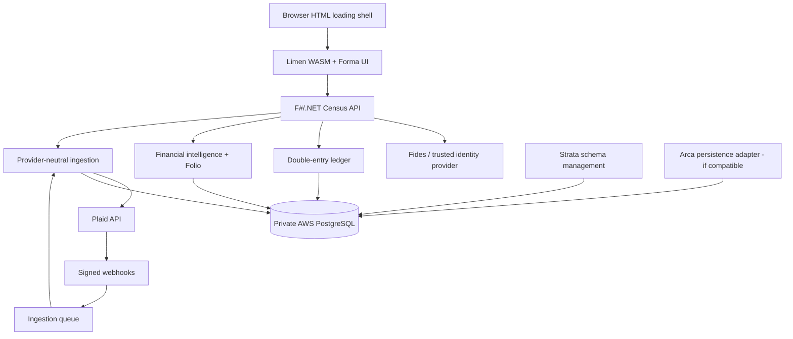
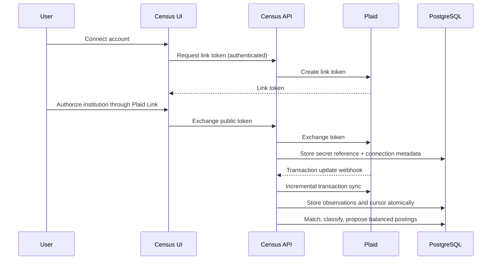
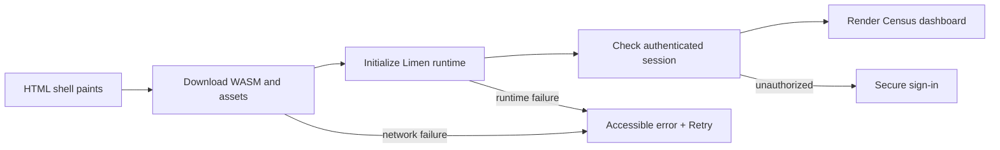

# Census architecture

These are proposed component relationships, subject to verification against installed Echelon releases.

## Boundary rules
- Browser has no Plaid access token, DB credentials or signing secrets.
- Identity is server-verified; authorization always occurs on API.
- Plaid observations are not journal postings.
- Journal posting is balanced, transactional and immutable.
- Provider sync cursor is committed with the complete observation batch.
- GitHub Pages can serve only public, cache-safe shell assets, never private financial records.
